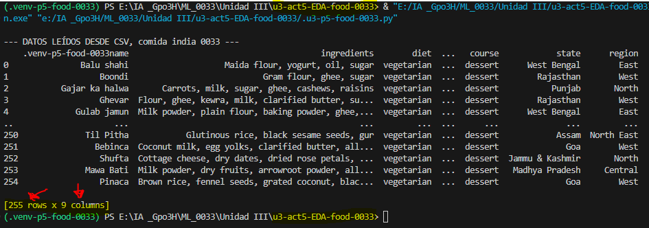
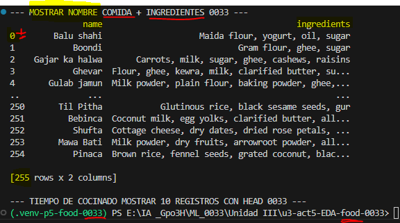

## Analisis exploratorio de datos
## Comida del pais India 
##  Alumno : Keyla Paola NC = 0033

### --- Importando datos del CSV comida India ---

### --- Mostrar Nombre comida + Ingredientes ---

### --- TIEMPO DE COCINADO MOSTRAR 10 REGISTROS CON HEAD 0033 ---
