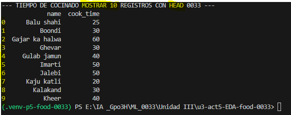
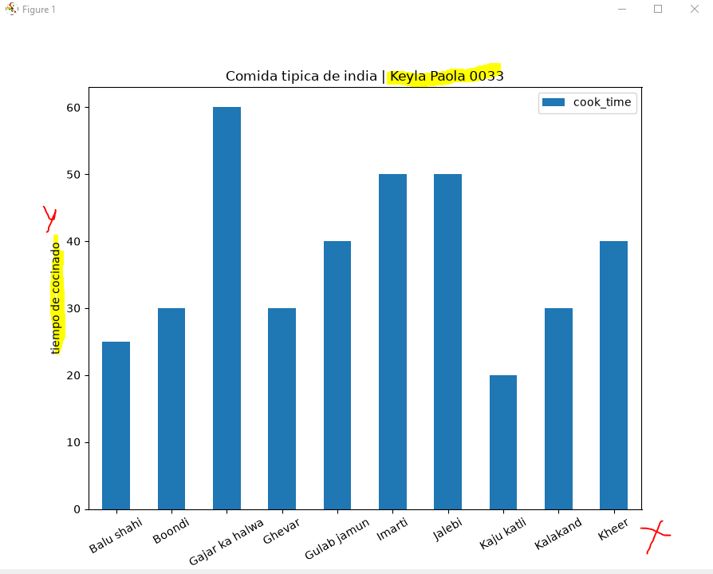
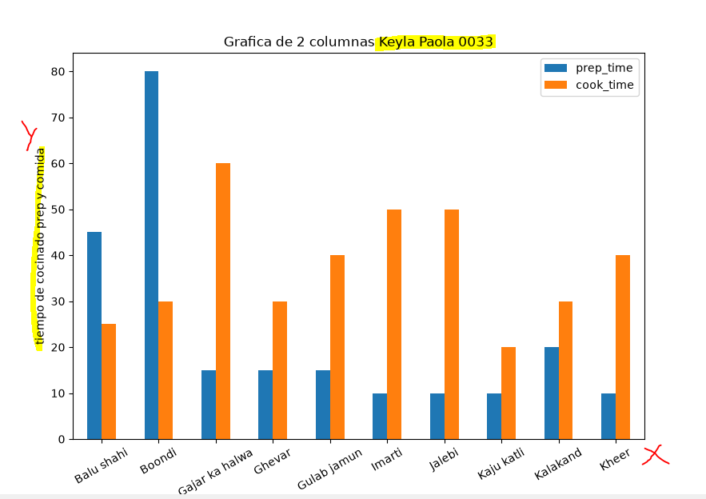
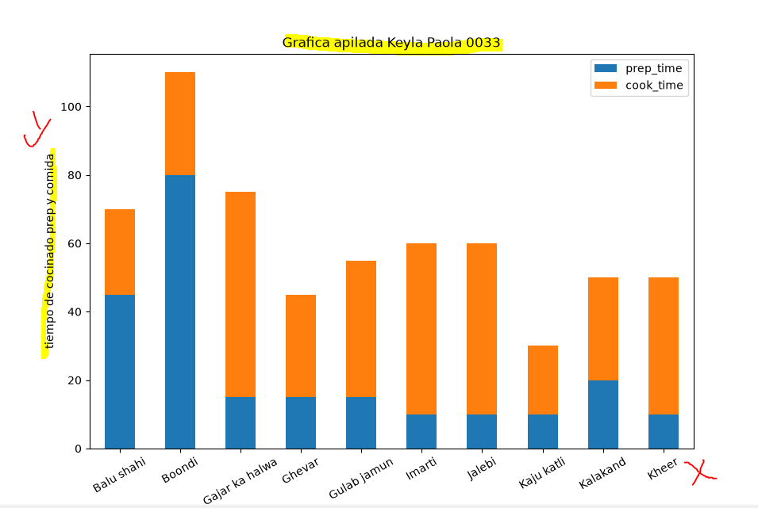

## Analisis exploratorio de datos
## Comida del pais India 
##  Alumno : Keyla Paola NC = 0033

### --- Importando datos del CSV comida India 0033 ---

### --- Mostrar Nombre comida + Ingredientes 0033 ---

### --- TIEMPO DE COCINADO MOSTRAR 10 REGISTROS CON HEAD 0033 ---

### --- Creación de gráficos de barras con Pandas 0033 ---

### --- gráfica de varias columnas  0033---

### --- graficas apiladas una tras otra verticalmente 0033 ---
